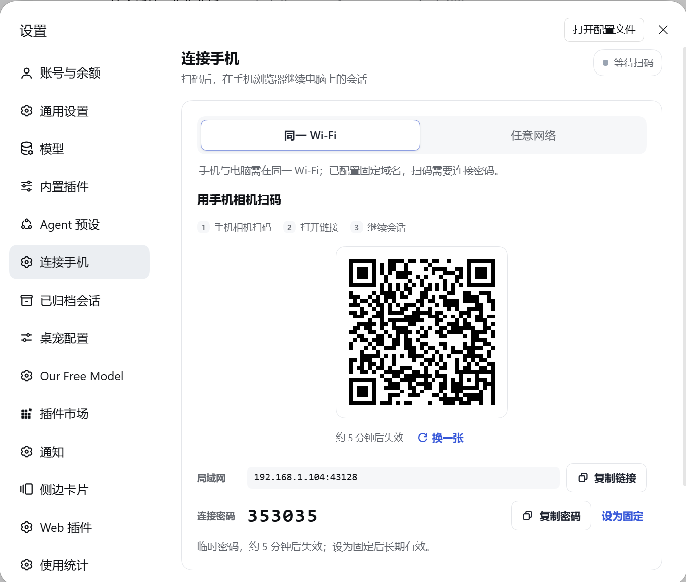
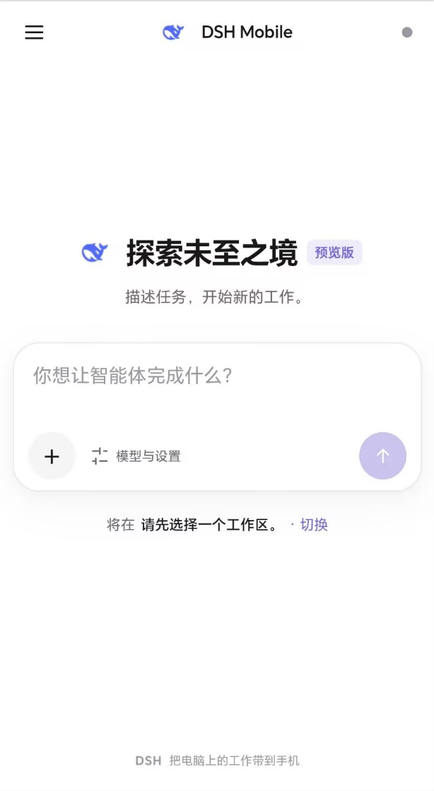

# dsh-roam

**电脑在跑任务，你不一定要一直坐在电脑前。**

dsh-roam 远程连接电脑与手机：把 DeepSeek Harness 的会话带到手机浏览器，看看进展、补一句要求、处理需要你确认的工具调用，或者在外面重新开一个小任务。扫码就能用，不用远程桌面，也不用安装 App。

[English](#english) · [安装与使用](#安装与使用) · [连接方式](#连接方式) · [1.2.0 更新内容](#120-更新内容)

> 这是一个独立的 DeepSeek Harness 插件，不是 DeepSeek 官方出品的手机客户端。手机端只有浏览器界面，不依赖任何 App。

## 它能帮你做什么

- **接着聊**：电脑正在进行的会话，手机上可以继续提问、补充要求。
- **新开任务**：在首页写下想做的事，选择工作区、模型、思考强度和会话模式，发送后就开始。
- **少一点等待**：查看待办和工具进展；需要授权或回答问题时，在手机上直接处理。
- **随手带资料**：相册、拍照、粘贴图片，或发送其他文件。
- **不用担心找不到会话**：左上角打开抽屉，最近、已归档、搜索、切换工作区都在这里。
- **知道谁连过**：「连接设备」显示本次运行中的配对会话、最近请求时间和状态，不把旧连接误报成在线。

它只做手机上的任务交互，不把完整桌面 IDE 塞进手机。终端、插件管理和复杂文件操作仍然留在电脑上。

## 安装与使用

### 先准备

- 电脑运行 **DeepSeek Harness 0.2.x**，Node.js 为 **22.19 或更新版本**。
- 手机有浏览器即可，不需要安装应用。
- 最简单的情况：电脑和手机连接同一个 Wi-Fi。

### 安装插件

**在 DSH 里安装（推荐给大多数朋友）**

打开 **设置 → 插件市场**，搜索 **dsh-roam**，点击安装，然后重启 DSH。

**喜欢用命令行，也可以这样安装：**

```bash
dsh plugin --profile web add dsh-roam@1.2.0
```

装好后进入 **设置 → 连接手机**。



### 第一次连接

1. 在「连接手机」里选择 **同一 Wi-Fi**。
2. 用手机相机扫描页面上的二维码。
3. 浏览器打开首页后，输入第一句话，发送即可创建会话。
4. 想继续之前的工作，点左上角 **☰**，从左侧抽屉选择会话。

二维码是一次性的，5 分钟内有效；过期或已经用过，点「换一张」即可。



公网入口会要求输入页面显示的 **6 位连接密码**。浏览器会话只保存在内存中，插件或 DSH 重启后需要重新扫码，这是为了不给旧连接留下长期有效的入口。

## 连接方式

| 你的情况 | 建议用法 |
| --- | --- |
| 电脑和手机在家或同一个办公室 Wi-Fi | 选 **同一 Wi-Fi**，扫码即可，最省事 |
| 临时出门，手边没有域名 | 在 **高级设置 → 网络配置** 开启临时隧道，优先 Cloudflare，失败可回退 Pinggy |
| 有自己的域名，准备长期使用 | 配置固定域名 + frpc / SakuraFrp，再申请证书 |

**没有域名也能用**：临时隧道不需要你购买域名，也不需要配置固定公网 IP。隧道地址每次开启可能变化，适合临时使用；手机记得重新扫码。若希望地址长期不变，再配置自己的域名。

固定域名目前支持 HTTPS 和 Let's Encrypt 证书申请/续期。详细的 frpc 配置、数据目录和安全边界见[连接与安全](#连接与安全)。

## 手机上具体能用哪些功能

- 新建首页直接输入任务，发送后才创建会话。
- 全屏聊天，模型、思考强度和会话模式都可以从输入卡调整；会话模式在第一条消息后锁定。
- 图片多选、拍照、粘贴，自动压缩后发送；历史图片可放大查看。
- 文件先上传，再随消息发送；历史显示文件名和大小，文件内容暂时请在电脑端查看。
- 工具审批「允许一次」或「拒绝」。
- 生成中可排队补充；想立即改变方向，点「打断」。
- 长会话可「加载更早」，回看时保持阅读位置。
- 会话重命名、归档、取消归档、按标题或内容搜索；全文搜索不可用时退回标题过滤。
- 待办、提问、连接状态和最近设备一目了然。

## 连接与安全

dsh-roam 默认不把你的工作台直接暴露出去：

- 设置管理接口只接受电脑本机回环请求，并校验 Host 和同源。
- 二维码令牌一次性、5 分钟有效；公网入口必须输入 6 位密码，连续输错会限速。
- 浏览器只接受服务端签发的 Cookie，不因为来自同一个 IP 就自动放行。
- 修改连接密码会立即使已连接的浏览器失效。
- **没有应用层端到端加密**。公网 TLS 在 Cloudflare、Pinggy、frps 或反向代理处终止，相关运营方理论上可以看到会话明文。内容比较敏感时，建议使用自己控制的固定域名和反向代理，或只在可信局域网使用。

本地设置、连接密码和证书状态位于 `%USERPROFILE%\.dsh\dsh-roam`（`DSH_HOME` 可覆盖）。没有遥测，也没有插件自己的账号体系。只有开启临时隧道或申请/续期证书时，才会连接相应外部服务。

## 1.2.0 更新内容

**这一版，手机端终于更像一个能随手拿起来用的工作台了。**

- **首页更清净**：只保留当前要做的事，最近会话不再挤占首屏。
- **找会话更顺手**：左上角 ☰ 打开左侧抽屉，工作区、搜索、最近会话、归档都在这里。
- **聊天更像手机**：独立返回、清楚的标题和运行状态、底部输入区，模型与模式选择也换成了适合触屏的底部面板。
- **小细节补上了**：键盘和焦点、弹层返回、流式消息、长会话阅读位置、慢请求切换会话，以及发送失败后的草稿和附件保留。
- **连接情况看得见**：新增「连接设备」，活跃会话有几个、最近什么时候有请求、是否手动断开，一看就明白。
- **第一次来也能看懂**：README 增加中英文说明、真实手机与设置截图，安装、连接和使用路径重新梳理。

完整的兼容边界、测试记录和升级说明见 [1.2.0 发布说明](docs/releases/v1.2.0.md)。

## 常见问题

**手机打不开二维码里的地址？** 先确认电脑和手机确实在同一个 Wi-Fi，防火墙允许面板显示的端口。端口不是 43128 时，以页面显示为准。

**隧道连不上？** 多半是 cloudflared 下载失败，换个网络再试，或改用固定域名。临时隧道每次地址可能不同，出门前重新扫码。

**为什么升级后要重新扫码？** 浏览器会话只存在内存里，插件重启后旧 Cookie 不再有效。设置和公网配置不会因为升级被删除。

## 开发与发布

```bash
pnpm install --frozen-lockfile
pnpm build
pnpm test
pnpm test:browser
npm pack --dry-run
```

`src/` 是源码，`lib/` 是构建产物，不要直接修改后者；提交前请先跑完上面的构建与测试。

当前验证：20 个 Node 测试文件、226 条测试通过；真实 Chrome 移动交互验收 24/24 通过。Android / iOS 真机、Safari、Firefox 和真实桌面 Host 的完整回归仍需要继续验证，移动模拟不等于真机测试。

- [npm 包](https://www.npmjs.com/package/dsh-roam)
- [GitHub Releases](https://github.com/winlin926/dsh-roam/releases)
- [更新日志](CHANGELOG.md)
- [第三方许可](THIRD_PARTY_NOTICES.md)

## 许可证

MIT，Copyright (c) 2026 winlin926。

---

<a id="english"></a>

# dsh-roam (English)

**Your computer can keep working even when you are not sitting in front of it.**

dsh-roam is a remote connection to your DeepSeek Harness sessions from a phone browser: check progress, add a requirement, approve a tool call, or start a small task while you are away. Scan a QR code and you are in — no remote desktop, no extra app.

[中文说明](#dsh-roam) · [Install and connect](#install-and-connect) · [Connection options](#connection-options) · [What is new in 1.2.0](#whats-new-in-120)

> An independent plugin for DeepSeek Harness, not an official DeepSeek mobile client. The phone side is browser-only — no app required.

## Why you might want it

- **Continue a conversation** started on your computer, right from your phone.
- **Start something new** with a workspace, model, reasoning effort and session mode of your choice.
- **Keep work moving** with to-dos, tool progress, questions and approval prompts.
- **Bring context along** with photos, camera capture, pasted images and other files.
- **Find your sessions** in the left drawer: recent, archived, search and workspace switching.
- **See what connected** with recent request times and honest status — an old pairing is not presented as an active connection.

It is a phone-friendly task interface, not a miniature desktop IDE. Terminals, plugin management and advanced file work stay on your computer.

## Install and connect

### What you need

- DeepSeek Harness **0.2.x** on your computer, with Node.js **22.19+**.
- A phone browser. Nothing to install on the phone.
- For the simplest setup, connect the phone and computer to the same Wi-Fi.

### Install the plugin

**In DSH (recommended):** open **Settings → Plugin Marketplace**, search for **dsh-roam**, install it and restart DSH.

**Or use the command line:**

```bash
dsh plugin --profile web add dsh-roam@1.2.0
```

Then open **Settings → Connect Phone**.


### Pair your phone

1. Choose **Same Wi-Fi**.
2. Scan the QR code with your phone camera.
3. Type your first request on the new-task home screen and send it to create a session.
4. To continue earlier work, tap **☰** in the top-left corner and choose a session in the drawer.

The QR token is single-use and valid for five minutes. If it expires or has already been used, select **New QR code**.


Public connections ask for the **6-digit pairing password** shown in the panel. Browser sessions live in memory only, so pairing again is required after the plugin or DSH restarts. Old connections are intentionally not kept alive indefinitely.

## Connection options

| Your situation | Recommended option |
| --- | --- |
| Phone and computer on the same Wi-Fi | **Same Wi-Fi** — the easiest setup |
| Away temporarily, without a domain | Enable the temporary tunnel in **Advanced Settings → Network Configuration**. Cloudflare is tried first, with Pinggy as fallback |
| A domain of your own for long-term use | Configure a fixed domain with frpc / SakuraFrp and request a certificate |

**A domain is not required.** A temporary tunnel needs neither a purchased domain nor a fixed public IP. Its address can change each time it starts, so scan the new QR code when needed. For a stable long-term address, use your own domain.

Fixed domains support HTTPS and Let's Encrypt certificate issuance/renewal. See [Connection and security](#connection-and-security) for the boundaries and local data locations.

## What is new in 1.2.0

**This release makes the phone feel like a workspace you can actually pick up and use.**

- A clean new-task home screen, without recent sessions taking over the first view.
- A shared left drawer for workspaces, recent conversations, archives and search.
- A proper mobile chat experience with a visible back button, clear session status and a comfortable bottom composer.
- Better small details: keyboard and focus behavior, overlay navigation, streaming message nodes, reading anchors, slow-request isolation, and drafts/attachments that survive a failed send.
- A new **Connected devices** card with active pairing counts, recent request times and honest disconnected/idle states.
- A friendlier bilingual README with real mobile and settings screenshots, clearer installation and connection guidance.

See the [1.2.0 release notes](docs/releases/v1.2.0.md) for compatibility notes and validation.

## Connection and security

- Management routes accept loopback requests only and validate Host and same-origin rules.
- Pairing tokens are single-use and time-limited. Public access requires a 6-digit PIN and rate-limits repeated failures.
- Only server-issued browser cookies are accepted; an IP address alone never grants access.
- Changing the pairing PIN immediately revokes connected browser sessions.
- **There is no application-layer end-to-end encryption.** Public TLS terminates at Cloudflare, Pinggy, frps or your reverse proxy, whose operator could theoretically read session traffic. For sensitive work, use infrastructure you control or stay on a trusted LAN.

Settings, PIN state and certificate data live in `%USERPROFILE%\.dsh\dsh-roam` (override with `DSH_HOME`). There is no telemetry or plugin account system. External connections are used only for temporary tunnels and certificate operations.

## Development and release

```bash
pnpm install --frozen-lockfile
pnpm build
pnpm test
pnpm test:browser
npm pack --dry-run
```

Source lives in `src/`; generated files in `lib/` should not be edited by hand. Run the full build and test suite above before contributing.

Validation currently includes 226 passing Node tests across 20 files and 24 passing real-Chrome mobile interaction cases. Full physical Android/iOS, Safari, Firefox and real desktop-Host regression is still needed; mobile emulation is not a substitute for device testing.

- [npm package](https://www.npmjs.com/package/dsh-roam)
- [GitHub Releases](https://github.com/winlin926/dsh-roam/releases)
- [Changelog](CHANGELOG.md)
- [Third-party notices](THIRD_PARTY_NOTICES.md)

MIT License, Copyright (c) 2026 winlin926.
